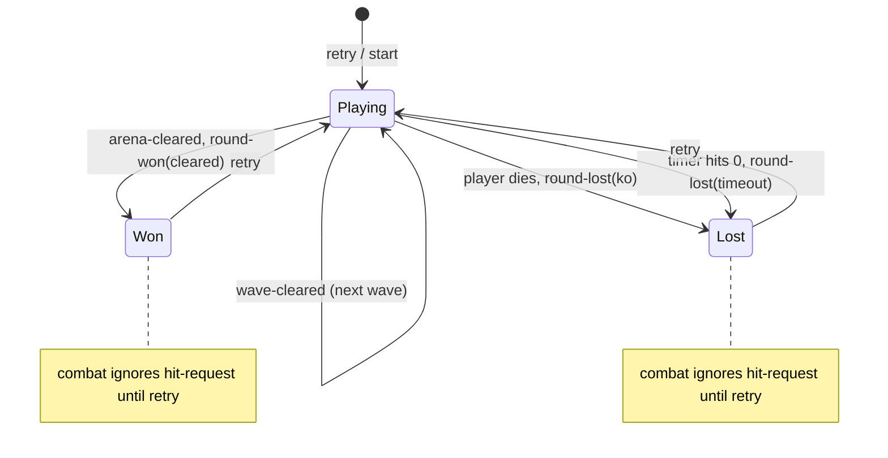

# Content brief: dialogue
_Generated 2026-10-19T12:55:44.448Z by pipeline/brief.mjs. Regenerate with `node pipeline/brief.mjs dialogue`; do not hand-edit._

**Writer agent:** dialogue-agent  |  **Output dir:** `content/dialogue/`  |  **Produces:** Zed barks, Rust notices/taunts, win/lose/retry lines, poster copy.

## Rules (non-negotiable)
1. Ground every item in the GDD. Cite corpus chunk ids in `sources` (ids are the `[...]` tags below). Cite only chunks you actually used.
2. Never invent lore silently. If the GDD states it, `status: "canon"`. If you are extending it, `status: "proposed"` and fill `gddGap` (which gap, why it fits). The owner approves proposals.
3. Authority order when sources disagree: **primary** (owner's GDD docx) > **derived** (specs in design/) > **reference** (PDF drafts, review kit, README). The GDD pitch contains the typo "Rush": the name is **Rust**. The city is **the Fallen City**.
4. Voice: hopeful, energetic, full of personality; Zed's side warm and plain-spoken; the Rust cold and official but always answered or defaced by the community. Never grim, gory, sneering or military. Enemies are pushed back or knocked down, never killed.
5. Numbers stay in engine units and near the engine's Tier 0 values (see engine files). Do not edit anything under `src/`.
6. Banned patterns (the validator rejects them): `\bRush\b` (typo for "Rust" (the GDD pitch has this typo; never copy it)); `\bRusts\b` ("the Rust" is a collective: no "Rusts"); `\bFallen\b(?!\s+City)` ("Fallen" alone; say "the Fallen City"); `\bfallen city\b` (lower-case city name; write "Fallen City"); `\b(driven|pushed|kicked|cleared)\s+out\s+of\s+the\s+Rust\b|\bthe Rust (zone|area|smell|stain)\b` (Rust treated as a place or stain; it is a force of people); `\b(TARGETS? ELIMINATED|MISSION COMPLETE|HOSTILES? NEUTRALI[SZ]ED|NEUTRALI[SZ]E)\b` (military/clinical phrasing on Zed's side); `\b(YOU DIED|PATHETIC|LOSER|GAME OVER)\b` (gloating or grim lose-screen copy); `\b(gore|gory|blood|bloody|corpse|dismember\w*|brains|entrails|slaughter\w*|massacre\w*)\b` (gore; tone is never gory); `\b(kill|kills|killed|killing|murder\w*)\b` (lethal wording; enemies are knocked down / pushed back).
7. Write JSON files to `content/dialogue/` (one item object or an array per file, UTF-8). Then run `node pipeline/validate.mjs dialogue` and fix every error before you report back.

## Schema
Each item has these fields:
```json
{
  "id": "string, kebab-case, unique within its type",
  "status": "one of canon | proposed",
  "gddGap": "string; REQUIRED when status is \"proposed\", otherwise omit",
  "sources": "array of corpus chunk ids (at least 1)",
  "speaker": "one of zed | rust | narrator | neighbour | poster",
  "trigger": "one of fight_start | combo | heavy_hit | low_hp | block | wave_clear | level_won | lose_ko | lose_timeout | retry | pause | taunt | notice | poster | menu",
  "lines": "array of 3-8 strings, each <= 80 chars, varied so repeats do not grate",
  "level": "optional level id the lines are specific to"
}
```
Example:
```json
{
  "id": "zed-wave-clear",
  "status": "canon",
  "speaker": "zed",
  "trigger": "wave_clear",
  "lines": [
    "One block at a time.",
    "Keep the music playing.",
    "That one is for the garden."
  ],
  "sources": [
    "the-rebellion#7"
  ]
}
```

## Already exists (extend, don't duplicate)
- `zed-fight-start-brick-red-alley` fight_start (content/dialogue/extended.json)
- `zed-fight-start-mustard-row` fight_start (content/dialogue/extended.json)
- `zed-fight-start-greenline-courts` fight_start (content/dialogue/extended.json)
- `zed-fight-start-stewpot-gardens` fight_start (content/dialogue/extended.json)
- `zed-fight-start-songwindow-heights` fight_start (content/dialogue/extended.json)
- `zed-level-won-brick-red-alley` level_won (content/dialogue/extended.json)
- `zed-level-won-greenline-courts` level_won (content/dialogue/extended.json)
- `zed-level-won-songwindow-heights` level_won (content/dialogue/extended.json)
- `zed-pause` pause (content/dialogue/extended.json)
- `zed-grab-pickup` heavy_hit (content/dialogue/extended.json)
- `zed-wave-clear-stewpot-gardens` wave_clear (content/dialogue/extended.json)
- `zed-low-hp-songwindow-heights` low_hp (content/dialogue/extended.json)
- `rust-taunt-baton-scout` taunt (content/dialogue/extended.json)
- `rust-taunt-enforcer` taunt (content/dialogue/extended.json)
- `rust-taunt-dart-marksman` taunt (content/dialogue/extended.json)
- `rust-taunt-shield-sergeant` taunt (content/dialogue/extended.json)
- `rust-taunt-signal-warden` taunt (content/dialogue/extended.json)
- `rust-notice-screens` notice (content/dialogue/extended.json)
- `neighbour-cheer-level-won` level_won (content/dialogue/extended.json)
- `neighbour-low-hp` low_hp (content/dialogue/extended.json)
- `neighbour-retry` retry (content/dialogue/extended.json)
- `poster-community-defaced` poster (content/dialogue/extended.json)
- `poster-small-print-extra` menu (content/dialogue/extended.json)
- `narrator-level-intro` fight_start (content/dialogue/extended.json)
- `options-screen-title` menu (content/dialogue/options-menu.json)
- `options-header-audio` menu (content/dialogue/options-menu.json)
- `options-header-video` menu (content/dialogue/options-menu.json)
- `options-header-gameplay` menu (content/dialogue/options-menu.json)
- `options-header-accessibility` menu (content/dialogue/options-menu.json)
- `options-master-volume` menu (content/dialogue/options-menu.json)
- `options-music-volume` menu (content/dialogue/options-menu.json)
- `options-sfx-volume` menu (content/dialogue/options-menu.json)
- `options-mute-on-focus-loss` menu (content/dialogue/options-menu.json)
- `options-fullscreen` menu (content/dialogue/options-menu.json)
- `options-background-posters` menu (content/dialogue/options-menu.json)
- `options-screen-shake` menu (content/dialogue/options-menu.json)
- `options-hit-flash` menu (content/dialogue/options-menu.json)
- `options-timer-visibility` menu (content/dialogue/options-menu.json)
- `options-notice-display` menu (content/dialogue/options-menu.json)
- `options-reduced-motion` menu (content/dialogue/options-menu.json)
- `options-high-contrast` menu (content/dialogue/options-menu.json)
- `options-text-size` menu (content/dialogue/options-menu.json)
- `options-back` menu (content/dialogue/options-menu.json)
- `options-reset-defaults` menu (content/dialogue/options-menu.json)
- `options-apply` menu (content/dialogue/options-menu.json)
- `options-unsaved-notice` menu (content/dialogue/options-menu.json)
- `rust-notice` notice (content/dialogue/rust-and-community.json)
- `rust-taunt` taunt (content/dialogue/rust-and-community.json)
- `neighbour-cheer` wave_clear (content/dialogue/rust-and-community.json)
- `poster-benefit-title` poster (content/dialogue/rust-and-community.json)
- `poster-rust-notice-114` poster (content/dialogue/rust-and-community.json)
- `poster-small-print` menu (content/dialogue/rust-and-community.json)
- `rust-notice-doctrine` notice (content/dialogue/rust-gdd.json)
- `rust-notice-serial-rollcall` notice (content/dialogue/rust-gdd.json)
- `rust-notice-sealed-district` notice (content/dialogue/rust-gdd.json)
- `rust-overseer-announcement` notice (content/dialogue/rust-gdd.json)
- `rust-varr-order` notice (content/dialogue/rust-gdd.json)
- `neighbour-defaced-doctrine` poster (content/dialogue/rust-gdd.json)
- `neighbour-answers-serial` taunt (content/dialogue/rust-gdd.json)
- `neighbour-answers-curfew` notice (content/dialogue/rust-gdd.json)
- `zed-answers-overseer` taunt (content/dialogue/rust-gdd.json)
- `zed-answers-varr` taunt (content/dialogue/rust-gdd.json)
- `rust-iron-line-spawn` fight_start (content/dialogue/rust-gdd.json)
- `rust-iron-line-telegraph` taunt (content/dialogue/rust-gdd.json)
- `rust-iron-line-pushed-back` wave_clear (content/dialogue/rust-gdd.json)
- `zed-answers-iron-line` combo (content/dialogue/rust-gdd.json)
- `rust-breaker-spawn` fight_start (content/dialogue/rust-gdd.json)
- `rust-breaker-telegraph` taunt (content/dialogue/rust-gdd.json)
- `rust-breaker-pushed-back` wave_clear (content/dialogue/rust-gdd.json)
- `zed-answers-breaker` combo (content/dialogue/rust-gdd.json)
- `rust-watcher-spawn` fight_start (content/dialogue/rust-gdd.json)
- `rust-watcher-telegraph` taunt (content/dialogue/rust-gdd.json)
- `rust-watcher-pushed-back` wave_clear (content/dialogue/rust-gdd.json)
- `zed-answers-watcher` combo (content/dialogue/rust-gdd.json)
- `rust-copper-fang-spawn` fight_start (content/dialogue/rust-gdd.json)
- `rust-copper-fang-telegraph` taunt (content/dialogue/rust-gdd.json)
- `rust-copper-fang-pushed-back` wave_clear (content/dialogue/rust-gdd.json)
- `zed-answers-copper-fang` combo (content/dialogue/rust-gdd.json)
- `rust-halden-varr-spawn` fight_start (content/dialogue/rust-gdd.json)
- `rust-halden-varr-telegraph` taunt (content/dialogue/rust-gdd.json)
- `rust-halden-varr-pushed-back` wave_clear (content/dialogue/rust-gdd.json)
- `zed-answers-halden-varr` combo (content/dialogue/rust-gdd.json)
- `title-banner` menu (content/dialogue/title-screen.json)
- `title-tagline` menu (content/dialogue/title-screen.json)
- `title-press-prompt` menu (content/dialogue/title-screen.json)
- `title-loading-bar` menu (content/dialogue/title-screen.json)
- `title-wall-writing` poster (content/dialogue/title-screen.json)
- `title-stamp-extras` poster (content/dialogue/title-screen.json)
- `title-intro-card` menu (content/dialogue/title-screen.json)
- `zed-fight-start` fight_start (content/dialogue/zed.json)
- `zed-combo` combo (content/dialogue/zed.json)
- `zed-heavy-hit` heavy_hit (content/dialogue/zed.json)
- `zed-low-hp` low_hp (content/dialogue/zed.json)
- `zed-block` block (content/dialogue/zed.json)
- `zed-wave-clear` wave_clear (content/dialogue/zed.json)
- `zed-level-won` level_won (content/dialogue/zed.json)
- `zed-lose-ko` lose_ko (content/dialogue/zed.json)
- `zed-lose-timeout` lose_timeout (content/dialogue/zed.json)
- `zed-retry` retry (content/dialogue/zed.json)

### Upstream `lore` content you may reference
- `open-windows-music` Open Windows with Music
- `street-tournaments` Street Tournaments and Late-Night Sparring
- `corner-shops` The Corner Shops
- `zeds-mission` Taking the City Back
- `zeds-colours` Zed's City Colours
- `neighbours-and-friends` The Quiet After the Takeover
- `rust-grunt` Rust Grunt
- `zed` Zed
- `zeds-mother` Zed's Mother
- `zeds-father` Zed's Father
- `fallen-city` The Fallen City
- `brick-red-alley` Brick-Red Alley
- `food-stall` The Food Stall
- `community-garden` The Community Garden
- `basketball-courts` The Basketball Courts
- `local-heroes-murals` The Local Heroes Murals
- `surveillance-towers` Surveillance Towers and Propaganda Screens
- `the-neighbourhood` The Neighbourhood
- `the-rust` The Rust
- `rust-takeover` The Takeover
- `rust-notice-114` Rust Notice 114
- `local-heroes-benefit` Local Heroes Benefit
- `mustard-row` Mustard Row
- `greenline-courts` Greenline Courts
- `stewpot-gardens` Stewpot Gardens
- `songwindow-heights` Songwindow Heights
- `rust-origin` How the Rust Got Their Foot in the Door
- `commander-halden-varr` Commander Halden Varr
- `rust-takeover-timeline` Within Months: Curfews, Sealed Districts and Drones
- `rust-doctrine` Order is Strength. Freedom is Weakness.
- `rust-serial-numbers` Serial Numbers
- `rust-grunts-iron-line` Rust Grunts: The Iron Line
- `rust-bruisers-breakers` Rust Bruisers: The Breakers
- `rust-rangers-watchers` Rust Rangers: The Watchers
- `rust-copper-fangs` Rust Specialists: The Copper Fangs
- `rust-overseers` Rust Overseers: The Architects of Control
- `rust-rank-ladder` The Rust Ladder
- `neighbourhood-answer-to-doctrine` The Wall Answers Back

### Upstream `enemies` content you may reference
- `rust-iron-line-cordon` Rust Iron Line Cordon
- `rust-breaker` Rust Breaker
- `rust-watcher` Rust Watcher
- `rust-copper-fang` Rust Copper Fang
- `rust-halden-varr` Overseer Halden Varr
- `rust-overseer-voss` Overseer Kade Voss
- `rust-overseer-calder` Overseer Rhea Calder
- `rust-overseer-wren` Overseer Silas Wren
- `rust-overseer-holt` Overseer Dr. Maren Holt
- `rust-grunt` Rust Grunt

## Engine / spec files to stay compatible with
#### design/lore/canon.md
```
# Canon Sheet: The Rebellion: Fists of the Fallen City

Source of truth: `GameDesignDocument/The Rebellion.docx` (Pitch, Theme). Menu mock-up docx and `design/ux/menu-concept.md` are secondary and were checked against it. Nothing here is invented; gaps are listed under Open questions.

## Names and spellings

| Thing | Canonical | Notes |
|---|---|---|
| Game title | The Rebellion: Fists of the Fallen City | Menu may split it: title "THE REBELLION", subtitle "Fists of the Fallen City". |
| City | the Fallen City | Always with "City". Never "Fallen" alone. Pitch's "fight your way through Fallen" and "first of the Fallen city" should read "the Fallen City". |
| Hero | Zed | Player character. |
| Antagonist | the Rust | Corrupt private security force. Always "Rust", never "Rush". |
| Rust members | Rust enemies / Rust grunt | "Rust grunt" is the one Tier 0 enemy type (asset-manifest). GDD unit names: Rust Grunts "The Iron Line", Rust Bruisers "The Breakers", Rust Rangers "The Watchers", Rust Specialists "The Copper Fangs", Rust Overseers "The Architects of Control". |
| Rust leader | Commander Halden Varr | Name from the Rust section of the GDD; confirm with the owner (see Open lore questions). |
| Zed's side | the neighbourhood, the community, local heroes | Wording from Theme. |

## Factions

- **Zed and the neighbourhood:** warm, rounded, casual, expressive. Fights back to get the city back.
- **The Rust:** a force of people (uniform, symmetrical, visor, cold hue, boxy). Cold, harsh, official. Not a place, a smell, a stain or a status effect. Per the GDD they turned from a protective force into a militarized occupation that crushes resistance with brutal efficiency: "enforcers, hunters, and executioners", each unit trained to suppress civilians, eliminate rebels and maintain absolute control. Breakers use illegal muscle stimulants; Copper Fangs undergo psychological conditioning; recruits are given serial numbers.

## World (from Theme)

Lived-in, human, culturally rich. Corner shops, murals celebrating local heroes, open windows with music, basketball courts, food stalls, community gardens. Casual fits, expressive colours.

## Palette words

Mustard yellow, brick red, forest green, warm browns. Rust is the cold contrast (steel, visor cyan).

## Tone rules

- Hopeful, energetic, full of personality and stories. Fighting back, reclaiming a home.
- Zed's side is hopeful and never gloats; lose screens encourage a retry. Never gory (no blood or dismemberment wording).
- The Rust are menacing, as the GDD writes them: brutal, ruthless, and set on eliminating rebels. Their threat is stated plainly, not softened.
- Zed's side copy is warm and plain-spoken, in a neighbourhood voice. No military or clinical phrasing.
- Rust copy is cold, official and threatening (notices, orders, barks): "suppress", "crush", "eliminate rebels" are in character for the Rust. It is still shown as something the community answers or defaces.

## Wording

| Avoid | Prefer |
|---|---|
| Rush (typo) | Rust |
| "Rust has been driven out of the arena" (Rust as place or stain) | "The Rust have been pushed back." / "The Rust are on the run." |
| "Fallen" alone | "the Fallen City" |
| TARGETS ELIMINATED, MISSION COMPLETE, HOSTILES NEUTRALISED (on Zed's side, such as the win screen; Rust lines may say "eliminate rebels") | The block is ours again. / Nice work, Zed. |
| Generic game-speak (ENEMIES DEFEATED, ENEMIES LEFT) | Rust pushed back / Rust still standing (proposal; HUD owner decides) |
| Gloating lose text (YOU DIED, PATHETIC) | Time ran out. Shake it off and go again. |
| "Rust" plural as "Rusts" | "the Rust" takes plural verbs: "the Rust are...". |

## Zed Lore (story, as written by the owner)

### Zed — The Boy from Brick‑Red Alley

Zed grew up in the heart of Fallen City, in a neighbourhood painted with “corner shops, murals celebrating local heroes, open windows with music drifting out”. His block was known for its mustard‑yellow storefronts, forest‑green basketball courts, and the brick‑red alley where kids learned to fight, dance, and argue like family. It wasn’t perfect, but it was alive — culturally rich, loud, hopeful, and full of people who looked out for each other.

His mother ran a tiny food stall near the community garden, serving hot bowls of stew to anyone who needed a meal. His father, a muralist, painted the faces of local heroes across the district walls — cooks, musicians, activists, teachers — everyday people who kept Fallen City standing. Zed grew up believing that strength wasn’t about power; it was about protecting the people who gave your life meaning.

### The Fall of Fallen City

Everything changed when RUST, the private security force, swept through the districts. The document describes the city as “overtaken Rust a corrupt private Security Force” — and Zed saw it firsthand.

RUST didn’t arrive like soldiers; they arrived like thieves. They shut down the basketball courts. They fenced off the community gardens. They patrolled the alleys where kids used to play. They tore down murals — including his father’s — replacing them with surveillance towers and propaganda screens.

Zed’s father disappeared after confronting RUST officers during a mural teardown. His mother’s food stall was seized for “security violations.” Friends vanished. Neighbours were beaten. The city’s heartbeat went quiet.

Zed didn’t have a choice. He had to fight.

### Why Zed Fights

Zed isn’t a soldier. He’s a kid from a lived‑in neighbourhood who learned to fight the same way he learned to dance — through rhythm, instinct, and community.

His style reflects the game’s pillars:

- Impactful, fast-paced combat — Zed’s punches feel like brick‑red alley brawls, scrappy but sharp.
- Skill depth through combos and defence — he learned to juggle, dodge, and parry from street tournaments and late-night sparring behind corner shops.
- Wave-clearing under pressure — fighting groups is nothing new; he grew up protecting younger kids from trouble.

He fights not for glory, but to reclaim the places that shaped him — the food stalls, the murals, the music drifting from open windows. The city isn’t just his home; it’s his identity.

### Zed’s Personal Mission

Zed’s goal is simple: Take Fallen City back, one district at a time.

Every wave he clears, every arena he survives, every enemy he knocks down brings him closer to finding out what happened to his father — and to restoring the community that raised him.

He fights so kids can play in the basketball courts again. He fights so music can drift from open windows again. He fights so murals can rise again, celebrating real heroes — not corporate tyrants.

### Tone & Personality

Zed embodies the game’s theme: “hopeful, energetic, full of personality and stories.” He’s expressive, stubborn, and fiercely loyal. He cracks jokes mid-fight. He refuses to back down. He carries the city’s colours in his outfit — mustard yellow, brick red, forest green — as a reminder of what he’s fighting for.

## Open lore questions (GDD silent)

1. Does the Rust impose curfews or issue numbered notices? Menu poster "Rust Notice 114 / CURFEW" implies it. Treated as flavour, not canon, until the owner confirms.
2. Is "Rust" used as a plural noun ("the Rust are") or a collective singular ("the Rust is")? Sheet assumes plural.
3. Who is Zed (age, role, backstory)? Is there a named "local hero" on the murals? (Art currently shows Zed as a young street hero with short dark hair and brown skin; all of that is PLACEHOLDER, see `design/art/zed-pixellab-prompt.md`, not canon.)
4. Names of districts and arena locations. The Rust leader is Commander Halden Varr in the GDD Rust section; the "Architect" title and unit nicknames are GDD wording to confirm.
5. What does "get it back" mean in story terms (who held the city before)?
6. Is "Rust enemy" or "Rust grunt" the player-facing term for the enemy?
7. Is a Quit option meaningful in a browser build? (Also flagged in `design/ux/main-menu.md` Later list.)
```

#### design/lore/menu-copy.md
```
# Menu Copy (approved strings)

Approved by the Critic against `design/lore/canon.md`. Wording only. Layout, colours and sizes stay in `design/ux/`.

## Core

| id | text |
|---|---|
| menu.title | THE REBELLION |
| menu.subtitle | Fists of the Fallen City |
| menu.opt.fight | FIGHT |
| menu.opt.controls | CONTROLS |
| menu.opt.options | OPTIONS |
| menu.opt.quit | QUIT |
| menu.footer | W/S to choose  /  Enter to go |

## Background posters

| id | text |
|---|---|
| menu.poster.benefit.title | LOCAL HEROES BENEFIT |
| menu.poster.benefit.line | Keep the Lights On |
| menu.poster.rust.title | RUST NOTICE 114 |
| menu.poster.rust.struck | CURFEW (struck through, hand-inked cross-out) |

The poster is one line in the concept doc ("Local Heroes Benefit: Keep the Lights On"); splitting at the colon into title and line is allowed. If kept on one line, use the colon form.

## Small print (proposed, optional, ui picks any)

| id | text | poster |
|---|---|---|
| menu.small.shop | Corner shop open late. Come by. | benefit, cream |
| menu.small.court | Music at the court Saturday. Bring a friend. | benefit, cream |
| menu.small.garden | Garden crew needs hands. Bring gloves. | benefit, cream |
| menu.small.stall | Hot plates by the steps. Pay what you can. | benefit, cream |
| menu.small.rust | By order of the Rust. Lights out at nine. | Rust notice, brick red (pending open question 1 in canon) |

Rules for small print: monospace, short, no named characters or places (the GDD names none), no gore, nothing that makes the Rust a place.
```

## Retrieved GDD passages (36)
### [the-rebellion#10] primary - GameDesignDocument/The Rebellion.docx
Zed embodies the game’s theme: “hopeful, energetic, full of personality and stories.” He’s expressive, stubborn, and fiercely loyal. He cracks jokes mid-fight. He refuses to back down. He carries the city’s colours in his outfit — mustard yellow, brick red, forest green — as a reminder of what he’s fighting for.
Character – the Enemy
Enemy Faction Lore: RUST — The Private Security Force of Fallen City
Overview
Rust began as a private security contractor hired to “stabilize” Fallen City after years of political decay and rising crime. But once they were inside, they never left. Rust transformed from a protective force into a militarized occupation, tightening control over every district and crushing resistance with brutal efficiency.
Their name comes from their signature oxidized metal armour, a symbol of decay — a reminder that Fallen City is rotting under their rule.
Rust’s soldiers are not just guards. They are enforcers, hunters, and executioners. Each unit is trained to suppress civilians, eliminate rebels, and maintain absolute control.
⚙️ Rust’s Origin

### [the-rebellion#9] primary - GameDesignDocument/The Rebellion.docx
Skill depth through combos and defence — he learned to juggle, dodge, and parry from street tournaments and late-night sparring behind corner shops.
Wave-clearing under pressure — fighting groups is nothing new; he grew up protecting younger kids from trouble.
He fights not for glory, but to reclaim the places that shaped him — the food stalls, the murals, the music drifting from open windows. The city isn’t just his home; it’s his identity.
Zed’s Personal Mission
Zed’s goal is simple: Take Fallen City back, one district at a time.
Every wave he clears, every arena he survives, every enemy he knocks down brings him closer to finding out what happened to his father — and to restoring the community that raised him.
He fights so kids can play in the basketball courts again. He fights so music can drift from open windows again. He fights so murals can rise again, celebrating real heroes — not corporate tyrants.
Tone & Personality

### [the-rebellion#3] primary - GameDesignDocument/The Rebellion.docx
[table]
Agent | Development role | Gameplay Effect
Player Mechanics agent | Movement, jump, input handling | The player moves and feels responsive
Player combos Agent | One state machine for attacks, combos, cancel windows, hit stun | Light and heavy attacks chain into combos
Enemy Agent | Control the A.I Enemies | This will control the Enemies in the game
Game State Agent | Win check, lose state, time-out result, retry | Clear the arena to win; fail and retry have rules
Wave Spawner | Win check, lose state, time-out result, retry | Difficulty comes from how waves arrive
Asset & Animation Lead | Sprite source, animation list, hit stop and feedback | Punchy hits" and readable telegraphs
Health & Hitbox Agent | Owns health, damage values, and hitbox/hurt box data | Hits land, damage registers, the player can die
Camera & Bounds Agent (new) | Arena camera lock, world bounds, unreachable-enemy failsafe | Prevents the off-screen soft lock
Menu & UI Agent | Builds and owns every screen and on-screen element the player sees outside the arena action |  | The player can start a game, read the state of the fight, and see why they won or lost

### [the-rebellion#8] primary - GameDesignDocument/The Rebellion.docx
Everything changed when RUST, the private security force, swept through the districts. The document describes the city as “overtaken Rust a corrupt private Security Force” — and Zed saw it firsthand.
RUST didn’t arrive like soldiers; they arrived like thieves. They shut down the basketball courts. They fenced off the community gardens. They patrolled the alleys where kids used to play. They tore down murals — including his father’s — replacing them with surveillance towers and propaganda screens.
Zed’s father disappeared after confronting RUST officers during a mural teardown. His mother’s food stall was seized for “security violations.” Friends vanished. Neighbours were beaten. The city’s heartbeat went quiet.
Zed didn’t have a choice. He had to fight.
Why Zed Fights
Zed isn’t a soldier. He’s a kid from a livedin neighbourhood who learned to fight the same way he learned to dance — through rhythm, instinct, and community.
His style reflects the game’s pillars:
Impactful, fast-paced combat — Zed’s punches feel like brickred alley brawls, scrappy but sharp.

### [the-rebellion#11] primary - GameDesignDocument/The Rebellion.docx
Rust was founded by Commander Halden Varr, a former military strategist who believed order could only be achieved through fear. When Fallen City’s government collapsed, Varr seized the opportunity. He offered “protection” to the remaining officials, then quietly replaced them with Rust loyalists.
Within months:
Curfews became mandatory
Districts were sealed
Surveillance drones filled the sky
Anyone who resisted disappeared
Rust became the law. Rust became the city.
🔩 Rust’s Philosophy
Rust operates under a single doctrine:
“Order is strength. Freedom is weakness.”
They believe Fallen City must be rebuilt through force. Civilians are treated as assets to control, not people to protect. Rust’s soldiers are conditioned to see rebels — including Zed — as threats to the “greater good.”
Rust Unit Types Enemies
1. Rust Grunts — “The Iron Line”
The backbone of Rust’s force. Once ordinary citizens, they were coerced or manipulated into service. Their armour is cheap, rustcoated plating, and their helmets hide their identities — intentionally.

### [rebellion-menu-desgin#3] primary - GameDesignDocument/Rebellion menu desgin.docx
[table]
Settings | functions | Theme | What happens in game
Music volume | Controls the music | a slider. Posters-on-brick feels like it wants a street-ambience bed | Changes the game music level
SFX volume | a slider covering hits sounds parries and dodges | Same theme as the music volume | Change the SFX on or off
Fullscreen | Makes the screen Fullscreen | Same theme as the music volume | Makes the game screen big
Background posters (non-interactive)
"Local Heroes Benefit: Keep the Lights On": cream, forest-green text. Ties back to the original Local Heroes Mural idea.
Rust Notice 114, "CURFEW" struck through: brick red. It shows the Rust security force's control and the community defacing it.
Visual style
Flat shapes with torn, uneven edges (clip-path style); no gradients or glow.
Heavy condensed display type for titles and buttons, monospace for small print.
Palette: brick red #9C3B2E / #7A2F25, mustard #E1A92B, forest green #2F5D3A, warm brown #6B4A2F, cream #E8DCC0, near-black #1D1A16.
Implementation notes (Phaser)

### [the-rebellion#1] primary - GameDesignDocument/The Rebellion.docx
The Rebellion
Fists of the Fallen City
A Face Paced 2d Side Scrolling Brawler that lets you fight back against Corrupt private security force.
Executives Sections
The Pitch
The Rebellion first of the Fallen city is a Fast-paced 2D side-scrolling brawler where players fight through urban districts overtaken Rust a corrupt private Security Force. The game blends classic beat-‘me-up mechanics with modem combo systems character progression, and dynamic enemy behaviours. Take control of Zed and fight your way through Fallen to get it back.
The 3 Pillars of Game Play
[table]
Impactful, Fast-paced combat | Skill depth through combos and Defence | Wave-clearing under pressure
Punchy hits" with light and heavy attacks and pick-up objects, in a fast 2D side-scrolling brawl. | Combos and Juggle routes" on offense, plus block, dodge, and parry on defence. | Enemies spawn in waves, and the player must "Defeat Wave / Clear Arena to win the level in time frame", tracked by the Timer Agent.
The Win and Lose conditions.

### [the-rebellion#2] primary - GameDesignDocument/The Rebellion.docx
[table]
Win conditions | Lose conditions
Fight you way to the end of the level while beating Rust Enemies | Get knocked out by health bar or if time runs out
Core Loop of the game.
Wave Cleared
Enter City Level begins
Enemies Spawn
Fight
Combat tools
Level Won
Reach the end.
Lose State
Next Level begins
Game a loop.
game
Game Mechanics -what the players does.
Impactful Combat – punchy hits Players moves into an Areas were light and heavy pick-up objects.
Combos and Juggle routes
Defensive tools(block dodge, parry)
Enemies spawn to fight.
Defeat Wave / Clear Arena to win the level in time.
AI Architecture Team

### [the-rebellion#4] primary - GameDesignDocument/The Rebellion.docx
Team Lead agent
Builds the Agent Orchestration
None
Technical Strategy

### [the-rebellion#5] primary - GameDesignDocument/The Rebellion.docx
[table]
Agent | Technical constraint | Desponds On | Budget
Player Mechanics | Sprite animations for idle, walk, jump; input handling | Asset & Animation Lead | Token coast to make at least one character to move two hundred tokens
Player combos Agent | One state machine for attacks | Player Mechanics | Token Cost to make the combos work 200 tokens
Health & Hitbox Agent | Shared damage, health, and hitbox data that every agent reads | None | Size is medium so medium
Enemy Agent | Chase and attack behaviour, attacker cap, one enemy type first | Health & Hitbox, Asset & Animation / Asset & Animation | It is large as it will run the enemy note
Game State Agent | Win check, lose state, time-out result, retry | Health & Hitbox Agent | Medium cost of token
Wave Spawner | Spawn triggers, rate, cap, and positions | Enemy Agent | 
Asset & Animation Lead | Sprite source, animation list, hit stop, and feedback | None | Large as it runs the Animation
Camera & Bounds Agent (new) | Arena camera lock, world bounds, unreachable-enemy failsafe | Wave Spawner | 
Menu & UI Agent | HUD (health, timer), win/lose screens, menus | Game State, Health & Hitbox | Medium Token use as well
Team Lead agent | Builds the Agent Orchestration |  | 

### [the-rebellion#6] primary - GameDesignDocument/The Rebellion.docx
Game Engine
Phaser
Why Phaser is use for the game building for now.
2D side-scrolling: Phaser is built for 2D and has Arcade physics, sprite animation, and input handling.
Prototype goal: the GDD says Phaser is for "creating a playable prototype". It runs in the browser with no install, so playtesting and sharing a build are easy.
AI-assisted build: the Technical Strategy budgets in tokens, which suggests AI agents write the code. Phaser uses JavaScript or TypeScript, which AI agents oversee well, and it has plenty of documentation and examples.
Small scope: Tier 0 is one character, one enemy type, waves, and a timer. Phaser manages that without much setup.
Theme of the game
Background Themes
Takeaway: Livedin, human, culturally rich.
Corner shops, murals celebrating local heroes, open windows with music drifting out
Basketball courts, food stalls, community gardens
Characters feel connected — casual fits, expressive colours
Colour palette: mustard yellow, brick red, forest green, warm browns
Atmosphere: hopeful, energetic, full of personality and stories
The Story

### [the-rebellion#7] primary - GameDesignDocument/The Rebellion.docx
Character – the hero
Zed — The Boy from BrickRed Alley
Zed grew up in the heart of Fallen City, in a neighbourhood painted with “corner shops, murals celebrating local heroes, open windows with music drifting out” . His block was known for its mustardyellow storefronts, forestgreen basketball courts, and the brickred alley where kids learned to fight, dance, and argue like family. It wasn’t perfect, but it was alive — culturally rich, loud, hopeful, and full of people who looked out for each other.
His mother ran a tiny food stall near the community garden, serving hot bowls of stew to anyone who needed a meal. His father, a muralist, painted the faces of local heroes across the district walls — cooks, musicians, activists, teachers — everyday people who kept Fallen City standing. Zed grew up believing that strength wasn’t about power; it was about protecting the people who gave your life meaning.
The Fall of Fallen City

### [the-rebellion#12] primary - GameDesignDocument/The Rebellion.docx
Lore: Rust strips recruit of their names, replacing them with serial numbers. This erases individuality and ensures obedience.
Purpose: Crowd control, intimidation, frontline combat.
Attacks/Move Lists
Rust Jab Combo A quick 1–2–3 punch string.
Light damage
Used to interrupt the player
Often done in groups to create pressure
Helmet Headbutt A sudden forward lunge using their reinforced helmet.
Short windup
Causes brief stun
Used when the player is too close or grabs too often
2. Rust Bruisers — “The Breakers”
Massive enforcers enhanced with illegal muscle stimulants. Their Armor is reinforced with heavy plating, giving them a hulking silhouette.
Lore: Breakers are often former criminals promised freedom in exchange for loyalty. Rust chemically augments them, making them stronger but unstable.
Purpose: Shock troops, area denial, crushing resistance groups.
Attack/ Move lists
A downward smash with a reinforced gauntlet.
Medium startup
Causes ground bounce
Breaks player block
Signature “thud” sound on impact
2. Rust Uppercut
A rising punch fuelled by muscle stimulants.

### [the-rebellion#13] primary - GameDesignDocument/The Rebellion.docx
Launches the player
Antiair option
Used when the player jumps too often
3. Body Check
A shoulder slam using their plated armour.
Short dash forward
Knocks the player back
Can interrupt combos
Super armour during the dash
3. Rust Rangers — “The Watchers”
Agile units equipped with taser rifles, batons, and tracking visors.
Lore: Watchers are trained to hunt rebels through the city’s alleyways and rooftops. Their visors can scan heat signatures, making hiding nearly impossible.
Purpose: Longrange harassment, pursuit, reconnaissance.
Attack/ Move list
1. Taser Shot
A quick electric bolt fired from their taser rifle.
Light damage
Brief stun on hit
Used constantly to harass
Encourages the player to close distance
2. Baton Strike
A fast melee hit with their electrified baton.
Very quick startup
Interrupts player combos
Used when Zed gets too close
4. Rust Specialists — “The Copper Fangs”
Elite soldiers with advanced gear: electrified gauntlets, grappling hooks, and tactical shields.

### [the-rebellion#14] primary - GameDesignDocument/The Rebellion.docx
Lore: Chosen from the most loyal Rust members, Fangs undergo psychological conditioning to remove fear and hesitation. They are Varr’s personal favourites.
Purpose: Highpriority target elimination, bosstier encounters.
Attack/Move List
👊 Basic Attacks (Sharp, Controlled, Professional)
1. Fang Jab
A lightningquick electrified gauntlet jab.
Very fast startup
Brief stun on hit
Used to interrupt player combos
2. Copper Cross
A crosspunch with crackling electricity.
Medium damage
Causes stagger
Used after dodging a player attack
3. Shield Bash
A forward shove with their tactical shield.
Pushes the player back
Breaks guard
Used to create space for followup attacks
personal favourites.
5. Rust Overseers — “The Architects of Control”
Role: District bosses, strategic masterminds, Varr’s inner circle Theme: Control through surveillance, fear, and psychological domination Combat Style: Tactical, oppressive, each with unique mechanics
🧠 1. Overseer Kade Voss — “The Eye of the Market”
Boss Theme: Surveillance, prediction, drones, holograms

### [the-rebellion#15] primary - GameDesignDocument/The Rebellion.docx
Arena: Neon Market control hub with screens, drones, hologram emitters
Phase 1 — “Data Acquisition”
📡 Predictive Strike
Voss’s visor scans Zed, projecting a red line showing where he thinks Zed will move.
After 1s, a laser shot fires along that line
Forces players to break patterns
🛸 Drone Swarm
Summons 3–5 drones that orbit him.
Drones shoot small taser bolts
Destroyable
Creates bullethell pressure
🔍 Hologram Decoy
Creates 2 hologram copies.
Copies mimic movement but don’t attack
Real Voss flickers slightly
Forces target identification
📊 Data Spike
Voss slams his hand into a console.
Electric pillars erupt from the ground
Pattern changes each use
Punishes stationary players
Phase 2 — “System Override”
Triggered at 50% HP. Arena lights dim; drones turn red.
🧠 Predictive Lockdown
Voss’s visor locks onto Zed.
Zed’s special meter is disabled for 10 seconds
Voss becomes more aggressive
Forces reliance on fundamentals
🛸 Drone Fusion
Remaining drones merge into a MegaDrone.
Fires sweeping laser beams
Moves slowly
Adds a second bosslike threat
💥 Hologram Assault

### [the-rebellion#16] primary - GameDesignDocument/The Rebellion.docx
Now holograms can attack.
Each hologram performs a weak punch or shot
Real Voss attacks simultaneously
Creates chaotic multiangle pressure
⚡ System Crash (Super Move)
Voss overloads the arena grid.
Entire floor becomes electrified except safe zones
Safe zones shift every second
Forces constant movement
🔥 2. Overseer Rhea Calder — “The Iron Matron”
Boss Theme: Industrial power, machinery, brute force
Arena: Factory floor with conveyors, crushers, steam vents
Phase 1 — “Discipline Through Strength”
🔨 Forge Hammer Smash
Massive overhead hammer strike.
Shockwave travels across floor
Can break player guard
Slow but devastating
💢 Hydraulic Grab
Exosuit arms extend to grab Zed.
Long reach
Leads into a slam or throw
Super Armor during startup
🔥 Steam Burst Armor
Calder vents steam from her suit.
Grants temporary invulnerability
Pushes player back
Used to reset pressure
📦 Conveyor Trap
Activates conveyor belts.
Moves player toward crushers or hazards
Forces repositioning
Adds environmental danger
Phase 2 — “Factory Protocol”
Triggered at 40% HP. Calder’s exosuit glows red.

### [the-rebellion#17] primary - GameDesignDocument/The Rebellion.docx
🔧 Overclock Mode
Her attack speed increases.
Hammer swings faster
Grab startup reduced
Steam bursts more frequent
🛠 Industrial Barrage
Summons robotic arms from the background.
Arms punch or grab from offscreen
Telegraphs with flashing lights
Adds multidirectional threats
💥 Furnace Slam (Super Move)
Calder leaps and slams her hammer into the ground.
Creates molten cracks across the floor
Cracks explode after 2 seconds
High damage, large AoE
🌫 3. Overseer Silas Wren — “The Whisper on the Rooftops”
Boss Theme: Mobility, stealth, vertical control
Arena: Rooftop platforms, zip lines, breakable ledges
Phase 1 — “Silent Hunter”
🪝 GrappleDash Barrage
Silas zips between platforms.
Attacks from above or behind
Very fast
Hard to punish without prediction
⚔️ Skyline Snare
Throws electrified wire traps.
Traps restrict movement
Can immobilize briefly
Forces careful navigation
👣 Silent Step
Turns semiinvisible.
Only faint outline visible
Next attack is guaranteed critical
Used unpredictably
⬇️ Rooftop Execution
Dive attack from above.
High damage
Creates shockwave

### [the-rebellion#18] primary - GameDesignDocument/The Rebellion.docx
Punishes players who stay grounded
Phase 2 — “Ghost of the Skyline”
Triggered at 50% HP. Silas becomes faster and quieter.
🪝 Grapple Clone
Creates afterimages when grappling.
Afterimages perform fake attacks
Real Silas attacks from unexpected angle
⚡ Shadow Pulse
Silas releases a burst of energy.
Knocks player back
Resets spacing
Used after combos
🌫 Vanish Storm (Super Move)
Silas disappears completely.
Multiple silhouettes attack from all sides
Real Silas finishes with a heavy strike
Requires reading patterns
☣ 4. Overseer Dr. Maren Holt — “The Voice of Compliance”
Boss Theme: Chemicals, toxins, psychological control
Arena: Undercity lab with gas vents, toxin pools, fog zones
Phase 1 — “Chemical Control”
💨 Fear Gas
Releases purple fog.
Distorts player controls
Causes screen blur
Forces careful movement
🧪 Obedience Mist
Green fog that slows movement.
Reduces dodge distance
Makes combos harder
☣ Toxin Burst
Throws chemical vials.
Creates AoE damage zones
Zones linger
Controls space
💉 Sedative Shot
Fires a dart.
Reduces player attack speed
Used to punish aggressive players

### [the-rebellion#19] primary - GameDesignDocument/The Rebellion.docx
Phase 2 — “Doctor’s Orders”
Triggered at 40% HP. Holt’s suit glows with chemical pressure.
🧬 NeuroFog
Entire arena fills with fog.
Player vision reduced
Holt becomes harder to track
She uses stealth attacks
🧪 Corrosive Wave
Throws a large vial that explodes.
Creates spreading acid
Damages both player and Holt
Forces repositioning
☣ Compliance Protocol (Super Move)
Holt releases a massive chemical cloud.
Player controls reverse
Damage over time
Holt becomes extremely aggressive
⚡ 5. Overseer Halden Varr — “The Architect of Rust”
Boss Theme: Authority, mastery, hybrid combat
Arena: Corporate Tower command chamber
Phase 1 — “Authority”
⚡ Authority Strike
Electrified gauntlet punch.
High damage
Causes knockback
Fast startup
🛡 Command Shield
Deploys energy shield.
Blocks all frontal attacks
Must be flanked or broken
📡 Command Override
Summons Rust units.
Grunts, Rangers, or Specialists
Varr fights alongside them
🔧 Adaptive Counter
Varr changes stance based on player behavior.
Antiair stance
Antirush stance
Anticombo stance
Forces adaptation
Phase 2 — “Rust Protocol”

### [the-rebellion#20] primary - GameDesignDocument/The Rebellion.docx
Triggered at 30% HP. Varr dons full armor.
⚙ Hybrid Assault
Uses moves from all Rust unit types:
Breaker slam
Ranger taser shot
Fang gauntlet combo
Overseerstyle control attacks
🛸 Drone Command
Summons elite drones.
Drones fire lasers
Create bullethell patterns
⚡ Rust Collapse (Super Move)
Varr overloads his armor.
Massive AoE explosion
Arena walls electrify
Final phase becomes relentless

### [canon#12] derived - design/lore/canon.md - Tone & Personality
Zed embodies the game’s theme: “hopeful, energetic, full of personality and stories.” He’s expressive, stubborn, and fiercely loyal. He cracks jokes mid-fight. He refuses to back down. He carries the city’s colours in his outfit — mustard yellow, brick red, forest green — as a reminder of what he’s fighting for.

### [canon#6] derived - design/lore/canon.md - Tone rules
- Hopeful, energetic, full of personality and stories. Fighting back, reclaiming a home.
- Zed's side is hopeful and never gloats; lose screens encourage a retry. Never gory (no blood or dismemberment wording).
- The Rust are menacing, as the GDD writes them: brutal, ruthless, and set on eliminating rebels. Their threat is stated plainly, not softened.
- Zed's side copy is warm and plain-spoken, in a neighbourhood voice. No military or clinical phrasing.
- Rust copy is cold, official and threatening (notices, orders, barks): "suppress", "crush", "eliminate rebels" are in character for the Rust. It is still shown as something the community answers or defaces.

### [style-guide#9] derived - design/art/style-guide.md - 5. Characters and world
- Zed (pixel art): 128x128 frame, ~96px tall figure, mustard jacket, warm brown trousers, expressive casual fit. Facing right by default; flip for left. Pixel rules in section 1.
- Rust enemies: same frame size, uniform and symmetrical, visor, no personality colour. Contrast through cold hue and straight geometry versus Zed's rounded forms.
- Background: warm, busy mid-ground (corner shop, mural, court hoops, food stall, garden planters), calmer play lane. Background saturation and contrast lower than characters so fighters always pop. Play lane y 440 to 680 stays free of high-contrast detail.

### [agent-diagrams#5] derived - design/team/agent-diagrams.md - 4. Round lifecycle (game state)


### [win#2] derived - design/ux/win.md - Purpose
Tell the player they won **and why**. The GDD win condition is: "Fight your way to the end of the level while beating Rust enemies" and "Defeat Wave / Clear Arena ... in time". The screen must show that the arena was cleared and that it was done in time, using real numbers from the run.

### [flow#3] derived - design/ux/flow.md - Screen inventory (Tier 0)
| Screen | File | Phaser scene |
|---|---|---|
| Main menu | `main-menu.md` | `MenuScene` |
| HUD | `hud.md` | `HudScene` (runs in parallel over the arena scene) |
| Pause | `pause.md` | overlay in `HudScene` |
| Win | `win.md` | `ResultScene` (mode = win) |
| Lose | `lose.md` | `ResultScene` (mode = lose) |

### [canon#9] derived - design/lore/canon.md - The Fall of Fallen City
Everything changed when RUST, the private security force, swept through the districts. The document describes the city as “overtaken Rust a corrupt private Security Force” — and Zed saw it firsthand.
RUST didn’t arrive like soldiers; they arrived like thieves. They shut down the basketball courts. They fenced off the community gardens. They patrolled the alleys where kids used to play. They tore down murals — including his father’s — replacing them with surveillance towers and propaganda screens.
Zed’s father disappeared after confronting RUST officers during a mural teardown. His mother’s food stall was seized for “security violations.” Friends vanished. Neighbours were beaten. The city’s heartbeat went quiet.
Zed didn’t have a choice. He had to fight.

### [menu-concept#4] derived - design/ux/menu-concept.md - Background posters (non-interactive)
- "Local Heroes Benefit: Keep the Lights On": cream, forest-green text. Ties back to the original Local Heroes Mural idea.
- Rust Notice 114, "CURFEW" struck through: brick red. It shows the Rust security force's control and the community defacing it.

### [menu-copy#3] derived - design/lore/menu-copy.md - Background posters
| id | text |
|---|---|
| menu.poster.benefit.title | LOCAL HEROES BENEFIT |
| menu.poster.benefit.line | Keep the Lights On |
| menu.poster.rust.title | RUST NOTICE 114 |
| menu.poster.rust.struck | CURFEW (struck through, hand-inked cross-out) |
The poster is one line in the concept doc ("Local Heroes Benefit: Keep the Lights On"); splitting at the colon into title and line is allowed. If kept on one line, use the colon form.

### [critic-log#5] derived - design/lore/critic-log.md - Audited and fine
- Title "THE REBELLION" and subtitle "Fists of the Fallen City": match GDD title; "Fallen City" correct.
- Option labels Fight, Controls, Options, Quit: short, active, fit the voice. FIGHT suits the "Fists" title. Note that Options has no spec and Quit is not meaningful in a browser (open question 7 in canon).
- Poster "Local Heroes Benefit: Keep the Lights On": hopeful, community voice, matches the GDD's murals of local heroes. No change.
- Poster "Rust Notice 114 / CURFEW struck through": Rust is named as a force that issues orders, not a place, and the cross-out shows the community answering it. Tone is right. Caveat: the curfew and numbered notices are not in the GDD; logged as open question 1, treated as flavour.
- Rust/Rush: no occurrence of "Rush" in any menu text. The only instance is the GDD Pitch (item 2).

### [main-menu#5] derived - design/ux/main-menu.md - Layout table
| Element | Centre / anchor (px) | Size (px) | Tilt | Notes |
|---|---|---|---|---|
| Title strip "THE REBELLION" | centre 396,110 | 440x84 | -2 deg | Cream heavy condensed on near-black strip, torn edges |
| Subtitle "Fists of the Fallen City" | centre 396,176 | max width 440, 24 px | 0 | Mustard monospace |
| Fight strip | centre 396,270 | 360x64 | -2 deg | Default selected |
| Controls strip | centre 396,352 | 360x64 | +1.5 deg | |
| Options strip | centre 396,434 | 360x64 | -1 deg | |
| Quit strip | centre 396,516 | 360x64 | +2 deg | |
| Poster A "Local Heroes Benefit: Keep the Lights On" | centre 112,300 | 160x220 | -3 deg | Cream, forest-green text. Non-interactive |
| Poster B "Rust Notice 114" with "CURFEW" struck through | centre 112,540 | 160x200 | +2 deg | Brick red. Non-interactive |
| Footer hint "W/S select / Enter confirm" | right edge x=1248, baseline y=688 | auto, 20 px mono | 0 | Right-aligned, low emphasis, on the dark street |

### [agent-team-setups#9] derived - design/team/agent-team-setups.md - Setup B: Presentation Polish (3 existing agents + the Critic)
**Goal:** finish the screens and feel: UI hooked to real game events, final art specs, hit feedback, and a consistent world and voice across all of it.
| Teammate | Definition | Owns |
|---|---|---|
| `ux` | `ux-flow-designer` | `design/ux/` |
| `art` | `art-direction-agent` | `design/art/`, `assets/` |
| `ui` | `menu-ui-agent` | `src/ui/` |
| `critic` | `critic-agent` | `design/lore/` (canon sheet and change log). Wording-only fixes in `design/ux/` and `design/art/`; string fixes in `src/` go through the owner |
**What the Critic does:** builds `design/lore/canon.md` from the GDD, audits every player-facing string and spec for lore breaks (Rush/Rust, "Rust has been driven out of the arena" reading as a place, "Fallen" vs "Fallen City") and tone drift (clinical or grim copy against the hopeful, community voice), and **fixes at least one real inconsistency per pass**, logging each change in `design/lore/critic-log.md` with before/after. It never edits the GDD docx; it proposes GDD text fixes in the log. If a full audit finds nothing, it must say so rather than invent a problem.

### [critic-log#12] derived - design/lore/critic-log.md - Changes applied
| # | File | Item | Issue | Fix | Rule | Owner |
|---|---|---|---|---|---|---|
| 15 | `content/dialogue/options-menu.json` | `options-music-volume`, line 2 | Tone drift from the community voice (final wording: "Music drifting out of the open windows.") | Reworded to the open-windows image | Tone | content |
| 16 | `content/dialogue/options-menu.json` | `options-apply`, line 3 | Tone drift (final wording is plain and never scolding) | Reworded to plain, friendly copy | Tone | content |

### [the-rebellion-final-gdd#3] reference - PDf/The Rebellion- Final Gdd.pdf
Enemy Agent Control the A.I This will control the Game State Agent Enemies Enemies in the game Win check, lose Clear the arena to Wave Spawner state, time-out win; fail and retry result, retry have rules Asset & Animation Win check, lose Difficulty comes Lead state, time-out from how waves Health & Hitbox result, retry arrive Agent Sprite source, Punchy hits" and Camera & Bounds animation list, hit readable telegraphs Agent (new) stop and feedback Owns health, Hits land, damage Menu & UI Agent damage values, and registers, the player hitbox/hurt box data can die Arena camera lock, Prevents the off- world bounds, screen soft lock unreachable-enemy failsafe The player can Builds and owns start a game, read every screen and on- the state of the screen element the fight, and see why player sees outside they won or lost the arena action Technical Strategy

### [narrative-critic#4] reference - gdd-review-kit-main/reviews/narrative-critic.md - 4. Tone is contradictory and unanchored (MAJOR)
**Problem:** The document promises a gritty urban resistance story but describes the game in arcade terms, so tone is never established.
**Passage:** "Fast-paced," "punchy hits," "classic beat-'em-up mechanics," and "light and heavy pick-up objects" suggest a light arcade brawler. "Corrupt," "Fallen City," and "Rebellion" suggest a serious political tone. Nothing says which wins, or how the enemy and dialogue should sound.
**Why it matters:** The narrative pillars are unset. No dialogue, cutscenes, or environmental storytelling are mentioned, so the tone has no delivery mechanism.

## Need more?
`node pipeline/search.mjs "<query>" -k 8 --full` searches all 373 chunks across 37 documents.
